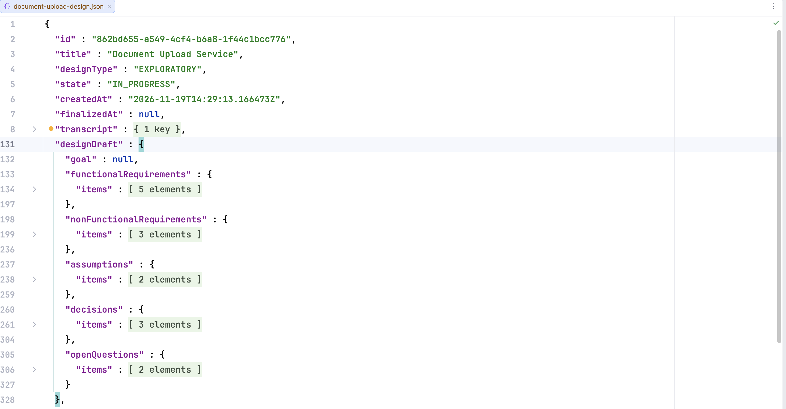
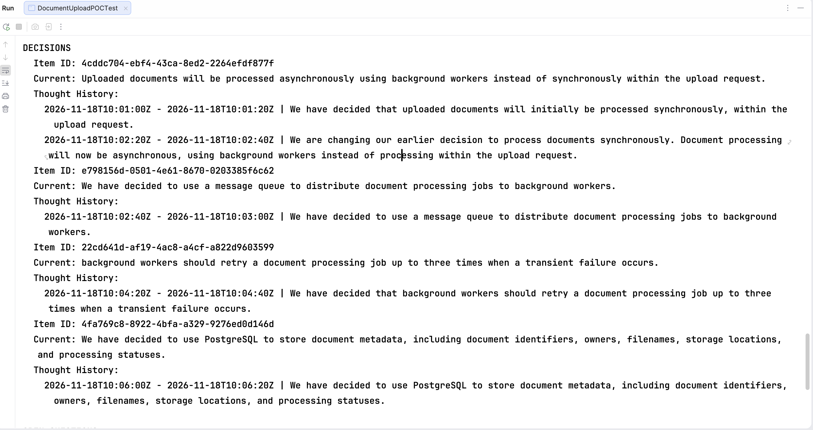
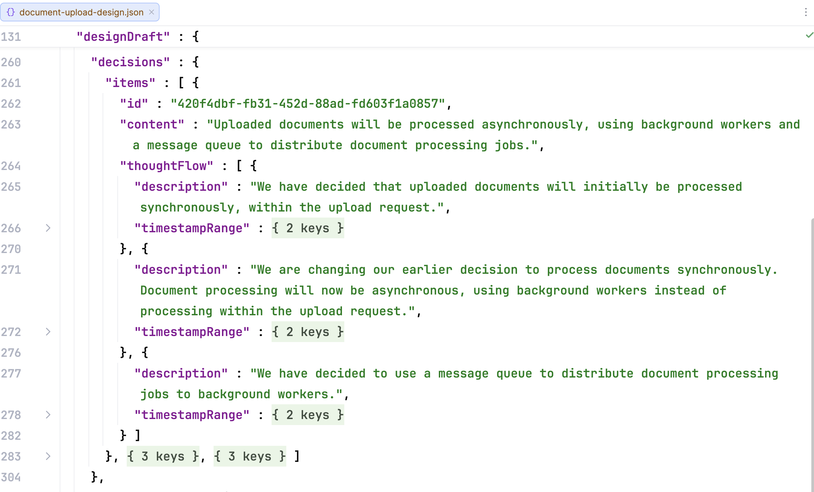

# Engineering Thought Recorder

**An AI-assisted proof of concept for capturing engineering discussions and tracking how software design decisions evolve.**

## Why I built this

Engineering design rarely happens in one meeting or one document.

Requirements evolve, assumptions get challenged, and architectural decisions change as teams discover new constraints. While design documents often capture the latest state, the reasoning behind those changes can be difficult to reconstruct.

Engineering Thought Recorder explores whether AI can help turn engineering discussions into structured, evolving design documentation while preserving the history of decisions.

This is a hands-on engineering experiment, not a production-ready application.

## What the POC demonstrates

- Processing engineering discussion transcripts as a sequence of segments.
- Using an LLM to identify design-relevant information from those discussions.
- Organizing extracted information into an evolving design representation.
- Capturing functional and non-functional requirements, assumptions, decisions, and open questions.
- Tracking how design decisions change as new information emerges.
- Generating a readable design document from the captured information.
- Persisting the complete design session as structured JSON, including timestamped transcripts, current design items, and their thought histories.
The project also contains components for experimenting with speech-to-text transcription.

## Example scenario

The demonstration explores a document-upload system whose design evolves during an engineering discussion.

For example:

| Earlier design | Evolving design |
|---|---|
| Synchronous processing | Asynchronous processing |
| 10 MB upload limit | 50 MB upload limit |

The objective is not simply to produce the latest design document, but to retain the context of how and why the design changed.


### Structured design capture — actual POC output

The Engineering Thought Recorder transforms a timestamped engineering discussion into a structured design draft.

In this Document Upload Service example, the POC captured 5 functional requirements, 3 nonfunctional requirements, 2 assumptions, 3 design decisions, and 2 open questions.

The complete session, including its transcript and thought histories, is also persisted as JSON for further inspection.



*Actual JSON output from the Engineering Thought Recorder POC, displayed in IntelliJ.*

### Design decision evolution — actual POC output

The screenshot below shows the output of a real POC execution.

The AI-assisted design capture process identifies a change from synchronous to asynchronous document processing and preserves both the original and revised decisions with timestamps.



*Actual IntelliJ console output from the Engineering Thought Recorder POC.*


### Architecture evolution — actual POC output

The POC captures how architectural decisions evolve during an engineering discussion.

In this Document Upload Service example, the design progressed through three stages:

1. Initially, documents were to be processed synchronously within the upload request.
2. The approach changed to asynchronous processing using background workers.
3. A message queue was introduced to distribute processing jobs to those workers.

The final design decision and all three original thoughts are preserved together in the generated JSON, including their timestamp ranges.



*Actual JSON output showing the evolution of an architectural decision and its recorded thought history.*


## Technology stack

- Java and Spring Boot
- Maven
- Groq-hosted LLM integration
- Groq Whisper speech-to-text integration
- PostgreSQL and Docker Compose
- JUnit-based tests

## Project structure

```text
src/
├── main/
│   ├── java/com/anu/engineeringthoughtrecorder/
│   │   ├── application/
│   │   ├── documentGeneration/
│   │   ├── domainObjects/
│   │   ├── peripherals/
│   │   └── persistence/
│   └── resources/
└── test/
```

The application separates orchestration, domain representation, AI integrations, document generation, and persistence.

## Running locally

### Prerequisites

- A compatible Java JDK (check `pom.xml` for the configured version)
- Maven or the included Maven wrapper
- Docker with Docker Compose
- Groq API credentials for AI-backed execution

### Database configuration

Create a local environment file from the example:

```bash
cp .env.example .env
```

Edit `.env` and set your local `POSTGRES_PASSWORD`.

Start PostgreSQL:

```bash
docker compose up -d
```

The Spring Boot application also needs the `POSTGRES_PASSWORD` environment variable supplied through your shell or IntelliJ run configuration. Docker Compose's `.env` file is not automatically loaded by Spring Boot.

### Running the demonstration

The project includes `DocumentUploadPOCTest.java`, which provides a predefined engineering-discussion scenario.

Open the project in IntelliJ, configure the required environment variables, and run the demonstration entry point.

AI-backed execution requires a valid Groq API key configured in the environment. Refer to the AI integration classes for the expected variable name.

## Current limitations

This repository represents an exploratory POC.

- There is no web-based user interface.
- The demonstration uses predefined discussion input rather than a complete end-user workflow.
- AI output depends on external model services.
- The project is not hardened for production deployment.
- Automated build and test compatibility should be verified in the target Java environment.

## Areas for further exploration

- Capturing discussions from real meetings.
- Improving the accuracy and traceability of extracted design decisions.
- Reviewing and correcting AI-generated design updates.
- Comparing design evolution across multiple sessions.
- Evaluating the engineering effort, reliability, and maintainability of AI-assisted workflows.

## Engineering learning

The broader purpose of this experiment is to explore how AI changes the way engineers build software, evaluate design decisions, and maintain technical context.

The implementation, limitations, and lessons learned are part of that exploration.

**Not a polished success story. An actual engineering experiment.**
